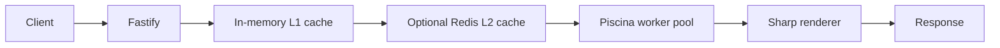

# Avatar Generation Service

A small avatar generation microservice built with TypeScript, Fastify, Sharp,
worker threads, and optional Redis caching. It creates repeatable PNG, WebP,
JPEG, or SVG avatars from a name or text value.


## Why this project exists

This repository is a practical reference for combining image rendering with a
non-blocking HTTP service. Its main areas of focus are:

- consistent initials, colors, and gradients for the same input;
- Unicode-aware text handling;
- worker-thread rendering with Piscina;
- in-memory and optional Redis caching;
- cache-stampede protection;
- request validation, rate limiting, health checks, and Prometheus metrics;
- a non-root, multi-stage container image.

The project does not claim a particular throughput, uptime, or security
certification. Measure it in your own environment before choosing production
limits.

## Requirements

- Node.js 20 or newer
- npm
- Redis (optional)

## Quick start

```bash
cp .env.example .env
npm ci
npm run dev
```

The service starts on `http://localhost:8083` by default.

```bash
curl "http://localhost:8083/v1/avatar?name=Jane+Doe&format=svg"
```

Development API documentation is available at `http://localhost:8083/docs`.
Swagger UI is intentionally disabled when `NODE_ENV=production`.

## API

`GET /v1/avatar` accepts the following query parameters:

| Parameter | Description | Default |
| --- | --- | --- |
| `name` | Required name or text, up to 100 characters | — |
| `width`, `height` | Image dimensions from 16 to the configured maximum | `128` |
| `format` | `png`, `webp`, `jpeg`, or `svg` | `png` |
| `shape` | `circle`, `square`, or `rounded` | `circle` |
| `mode` | `short` for initials or `long` for full text | `short` |
| `background`, `color` | Three- or six-digit hexadecimal colors | generated |
| `gradient` | Enable a name-based gradient | `false` |

Operational endpoints:

- `GET /health` — health and dependency status;
- `GET /metrics` — Prometheus metrics in development and test;
- `GET /docs` — Swagger UI outside production.

Production metrics are disabled by default. To expose them, set
`ENABLE_METRICS=true` and provide a random `METRICS_TOKEN` of at least 24
characters. Clients must send `Authorization: Bearer <token>`.

## Configuration

Copy [.env.example](./.env.example) and adjust it for your environment. Browser
origins are denied unless they appear in the comma-separated `CORS_ORIGINS`
value. Requests without an `Origin` header remain available for
service-to-service use.

`TRUST_PROXY` defaults to `false`. Enable it only when the service cannot be
reached except through a proxy you control.

## Docker

Build and run the service directly:

```bash
docker build -t fastify-avatar-service .
docker run --rm -p 8083:8083 --env-file .env fastify-avatar-service
```

The included Compose file expects an existing Docker network named
`avatar_gateway` and a Traefik instance on that network. It exposes the service
to the network without publishing the application port directly to the host.

## Architecture



## Quality checks

```bash
npm run check
npm run build
```

The check command runs TypeScript validation, ESLint, and the test suite. GitHub
Actions runs the same checks for pushes and pull requests.

For a local HTTP load test, start the service and use a tool such as
`autocannon`. Publish the command, hardware, concurrency, duration, image format,
and cache state with any benchmark result so that the result is reproducible.

## Security

Please read [SECURITY.md](./SECURITY.md) before reporting a vulnerability. SVG
text and font inputs are sanitized, but this should be treated as one layer in a
broader deployment security model rather than as a guarantee.

## Contributing

Contributions are welcome. See [CONTRIBUTING.md](./CONTRIBUTING.md) for the local
workflow and pull-request expectations.

## License

Licensed under the [MIT License](./LICENSE).
